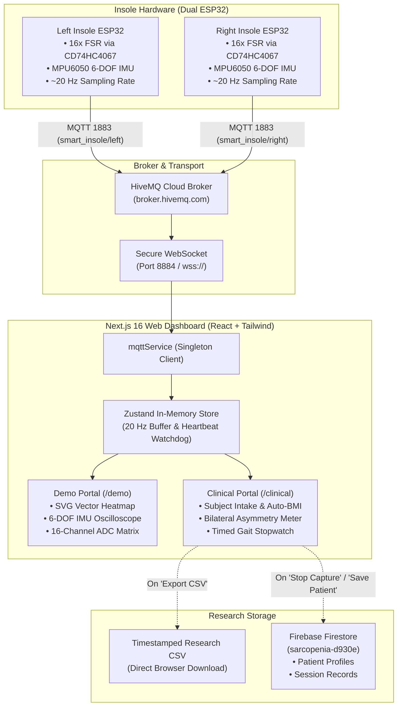

# 🦶 SarcoSense — Dual Smart Insole Plantar Pressure & Gait Telemetry System

A comprehensive, real-time cyber-physical health monitoring platform designed for **sarcopenia screening, gait asymmetry assessment, and fall-risk detection**. The system pairs bilateral ESP32 smart insoles (each equipped with 16 Force Sensitive Resistors and an MPU6050 6-DOF IMU) with a modern Next.js web dashboard over MQTT WebSockets.

---

## 📑 Table of Contents

1. [System Architecture](#-system-architecture)
2. [Repository Structure](#-repository-structure)
3. [Hardware & Wiring Specifications](#-hardware--wiring-specifications)
4. [ESP32 Firmware Configuration & Flashing](#-esp32-firmware-configuration--flashing)
   - [Configuring Insole Side](#1-configuring-insole-side-right-vs-left)
   - [Configuring WiFi & MQTT](#2-configuring-wifi--mqtt)
   - [Flashing via PlatformIO (Recommended)](#3a-flashing-via-platformio-recommended)
   - [Flashing via Arduino IDE](#3b-flashing-via-arduino-ide-alternative)
   - [Observing the Serial Monitor](#4-observing-the-serial-monitor)
5. [16-Channel FSR Sensor Mapping](#-16-channel-fsr-sensor-mapping)
6. [Next.js Web Dashboard](#-nextjs-web-dashboard)
   - [Local Setup & Launch](#1-local-setup--launch)
   - [Operating Portals (Demo vs. Clinical)](#2-operating-portals)
   - [Bilateral Balance & Fall Risk Index](#3-bilateral-balance--fall-risk-index)
   - [Research CSV Data Export](#4-research-csv-data-export)
7. [Cloud & Network Architecture](#-cloud--network-architecture)

---

## 🏗️ System Architecture



---

## 📂 Repository Structure

```
Sarcopenia/
├── ESP32/
│   ├── platformio.ini         # PlatformIO project configuration (esp32dev, libraries)
│   ├── src/
│   │   └── main.cpp           # Primary modular ESP32 firmware source code
│   └── main/
│       └── main.ino           # Arduino IDE compatible backup firmware
│
├── dashboard/                 # Next.js 16 Real-Time Web Application
│   ├── app/
│   │   ├── layout.tsx         # Root layout with dark medical theme
│   │   ├── globals.css        # Tailwind styling & custom scrollbar definitions
│   │   ├── page.tsx           # Gateway portal selector (/demo vs /clinical)
│   │   ├── demo/
│   │   │   └── page.tsx       # Demo Mode Dashboard (heatmaps, IMU curves, matrix)
│   │   └── clinical/
│   │       └── page.tsx       # Clinical Mode Dashboard (patient intake, balance index)
│   ├── components/
│   │   ├── heatmap/
│   │   │   ├── FootHeatmap.tsx    # Single-foot dynamic SVG heatmap
│   │   │   └── DualFootView.tsx   # Side-by-side Left & Right heatmap with balance meter
│   │   ├── charts/
│   │   │   ├── IMUChart.tsx       # 6-DOF rolling line chart (Accel + Gyro)
│   │   │   └── SensorTable.tsx    # 16-channel FSR telemetry table with pressure bars
│   │   ├── clinical/
│   │   │   └── ClinicalBalanceCard.tsx # Gait symmetry and fall-risk evaluation card
│   │   ├── patient/
│   │   │   ├── PatientCard.tsx    # Active subject profile & BMI badge
│   │   │   ├── AddPatientDialog.tsx # Subject registration with real-time BMI calculator
│   │   │   └── PatientList.tsx    # Subject directory and switcher drawer
│   │   ├── capture/
│   │   │   ├── CaptureControls.tsx# Stopwatch trial capture controller
│   │   │   └── SessionHistory.tsx # Past session archive modal
│   │   └── layout/
│   │       └── Navbar.tsx         # Universal navbar with MQTT status & mode switcher
│   ├── hooks/
│   │   └── useMQTT.ts         # React hook subscribing to live sensor store
│   ├── store/
│   │   ├── sensorStore.ts     # High-speed Zustand store (20 Hz in-memory telemetry)
│   │   └── patientStore.ts    # Subject registry state
│   ├── lib/
│   │   ├── mqttService.ts     # Singleton MQTT WebSocket client
│   │   ├── mqtt.ts            # Broker URL and configuration generator
│   │   ├── sensorMapping.ts   # 16-channel anatomical coordinate and color definitions
│   │   ├── footPaths.ts       # Extracted SVG contour coordinates for Left & Right insole
│   │   ├── exportCsv.ts       # RFC 4180 compliant research CSV generator
│   │   ├── patients.ts        # Firestore CRUD & BMI categorization
│   │   └── sessions.ts        # Session metadata storage
│   ├── public/
│   │   ├── insole.svg         # Cleaned reference SVG insole outline
│   │   └── foot-numbered.jpeg # Physical insole sensor numbering layout
│   └── package.json           # Dashboard dependencies and build scripts
│
├── SVG Image/
│   ├── L & R insole (1).svg   # Vector CAD file of insole pads
│   └── foot-numbered.jpeg     # Physical prototype labeling photograph
│
├── .gitignore                 # Excludes node_modules, build outputs, .pio, and .env
└── README.md                  # Complete system documentation
```

---

## 🔌 Hardware & Wiring Specifications

### 1. CD74HC4067 16-Channel Analog Multiplexer
Because the ESP32 ADC has limited dedicated pins while WiFi is active (ADC2 cannot be used concurrently with WiFi), all 16 FSR sensors are routed through a single multiplexer on **ADC1 (GPIO 34)**:

| Multiplexer Pin | ESP32 Pin | Role | Description |
|---|---|---|---|
| **S0** | **GPIO 19** | Output | Binary Select Bit 0 |
| **S1** | **GPIO 18** | Output | Binary Select Bit 1 |
| **S2** | **GPIO 17** | Output | Binary Select Bit 2 |
| **S3** | **GPIO 16** | Output | Binary Select Bit 3 |
| **SIG** | **GPIO 34** | Input (ADC1) | Analog voltage output from selected FSR (0–3.3V) |
| **VCC** | **3.3V** | Power | Board Supply |
| **GND** | **GND** | Ground | Common Ground |

### 2. MPU6050 6-DOF IMU (Accelerometer & Gyroscope)
Communicates over I²C at 400 kHz to measure foot orientation, step impact, and angular velocity:

| MPU6050 Pin | ESP32 Pin | Role |
|---|---|---|
| **SDA** | **GPIO 21** | I²C Serial Data |
| **SCL** | **GPIO 22** | I²C Serial Clock |
| **VCC** | **3.3V** | Power |
| **GND** | **GND** | Common Ground |

---

## ⚡ ESP32 Firmware Configuration & Flashing

The firmware is located at [`ESP32/src/main.cpp`](file:///Users/prabathwijethilaka/Downloads/Sarcopenia/ESP32/src/main.cpp).

### 1. Configuring Insole Side ("right" vs "left")
Open [`ESP32/src/main.cpp`](file:///Users/prabathwijethilaka/Downloads/Sarcopenia/ESP32/src/main.cpp) and edit line 16:

```cpp
// Set to "right" for the Right foot board, or "left" for the Left foot board:
#define FOOT_SIDE "right"
```
*When set to `"right"`, the ESP32 publishes to topic `smart_insole/right`. When set to `"left"`, it publishes to `smart_insole/left`.*

### 2. Configuring WiFi & MQTT
In [`ESP32/src/main.cpp`](file:///Users/prabathwijethilaka/Downloads/Sarcopenia/ESP32/src/main.cpp) (lines 28–36):
```cpp
// WiFi Settings
const char* ssid = "Hi 2024";
const char* password = "26262626";

// MQTT Broker Settings
const char* mqtt_server = "broker.hivemq.com";
const int mqtt_port = 1883;
```

### 3a. Flashing via PlatformIO (Recommended)
PlatformIO compiles all dependencies (`PubSubClient`, `Adafruit MPU6050`, `Wire`, `WiFi`) automatically.

1. Connect your ESP32 to your computer via USB (e.g. `/dev/cu.usbserial-0001`).
2. Put the board into download mode:
   - **Hold** the **`BOOT`** button (GPIO 0).
   - While holding `BOOT`, **press and release** the **`EN`** (Reset) button.
   - **Release** the **`BOOT`** button.
3. Run the upload command in your terminal:
   ```bash
   cd ESP32
   pio run --target upload
   ```

### 3b. Flashing via Arduino IDE (Alternative)
1. Install the ESP32 board package in Arduino IDE (`Boards Manager` -> search `esp32` by Espressif Systems).
2. Install required libraries from `Library Manager`:
   - `PubSubClient` (by Nick O'Leary)
   - `Adafruit MPU6050` & `Adafruit Unified Sensor`
3. Open [`ESP32/src/main.ino`](file:///Users/prabathwijethilaka/Downloads/Sarcopenia/ESP32/src/main.ino).
4. Under `Tools` -> `Board`, select **ESP32 Dev Module**.
5. Select your active COM/Serial Port under `Tools` -> `Port`.
6. Click **Upload** (hold `BOOT` button if the uploader hangs on `Connecting......._____`).
7. Open `Tools` -> `Serial Monitor` set to **115200 baud**.

### 4. Observing the Serial Monitor
To verify sensor readings and WiFi connection directly over USB:
```bash
cd ESP32
pio device monitor -b 115200
```
*Expected output (streaming at ~20 Hz):*
```json
{"foot":"right","ts":54802,"fsr":[0,0,116,0,0,0,0,0,0,0,0,0,0,0,0,0],"ax":0.06,"ay":0.47,"az":9.77,"gx":-0.03,"gy":0.03,"gz":0.02}
```

---

## 👣 16-Channel FSR Sensor Mapping (20-Pin Connector)

The physical smart insole ribbon cable contains 20 pins, where **pins 7, 10, 15, and 20 are unused / reference**, leaving **16 active pressure sensing pins**:
`[1, 2, 3, 4, 5, 6, 8, 9, 11, 12, 13, 14, 16, 17, 18, 19]`.

The ESP32 firmware reads the multiplexer channels and outputs the `fsr` array sorted in **Insole Pin order**:
`fsr[0] = Pin 1, fsr[1] = Pin 2, ..., fsr[15] = Pin 19`.

### Anatomical Layout & Dashboard Symmetry

```
         LEFT FOOT (Swapped)                      RIGHT FOOT (Standard)
       ┌────────────────────────┐              ┌────────────────────────┐
       │   [#11]        [#12]   │  <- Row 1 -> │   [#12]        [#11]   │
       │                        │   (Toes)     │                        │
       │   [#1]   [#9]  [#13]   │  <- Row 2 -> │   [#13]  [#9]   [#1]   │
       │                        │ (Forefoot)   │                        │
       │   [#2]   [#5]  [#14]   │  <- Row 3 -> │   [#14]  [#5]   [#2]   │
       │                        │  (Midfoot)   │                        │
       │   [#3]   [#6]  [#19]   │  <- Row 4 -> │   [#19]  [#6]   [#3]   │
       │                        │ (Lower Mid)  │                        │
       │   [#4]   [#8]  [#18]   │  <- Row 5 -> │   [#18]  [#8]   [#4]   │
       │                        │   (Arch)     │                        │
       │   [#17]        [#16]   │  <- Row 6 -> │   [#16]        [#17]   │
       └────────────────────────┘   (Heel)     └────────────────────────┘
         MEDIAL         LATERAL                  LATERAL         MEDIAL
        (Left Col)    (Right Col)               (Left Col)     (Right Col)
```

### Complete Insole Pin to MUX Channel & Payload Index Mapping Table

| Physical Foot Zone | Insole Pin (New) | Old Number | ESP32 Array Index | MUX Input Channel |
|---|---|---|---|---|
| **Big Toe** | **11** | 2 | `fsr[8]` | **C14** |
| **Lesser Toe** | **12** | 10 | `fsr[9]` | **C6** |
| **Forefoot Medial** | **1** | 1 | `fsr[0]` | **C15** |
| **Forefoot Center** | **9** | 15 | `fsr[7]` | **C1** |
| **Forefoot Lateral** | **13** | 6 | `fsr[10]` | **C10** |
| **Midfoot Medial** | **2** | 9 | `fsr[1]` | **C7** |
| **Midfoot Center** | **5** | 3 | `fsr[4]` | **C13** |
| **Midfoot Lateral** | **14** | 14 | `fsr[11]` | **C2** |
| **Lower Mid Medial** | **3** | 5 | `fsr[2]` | **C11** |
| **Lower Mid Center** | **6** | 11 | `fsr[5]` | **C5** |
| **Lower Mid Lateral** | **19** | 16 | `fsr[15]` | **C0** |
| **Arch Medial** | **4** | 13 | `fsr[3]` | **C3** |
| **Arch Center** | **8** | 7 | `fsr[6]` | **C9** |
| **Arch Lateral** | **18** | 8 | `fsr[14]` | **C8** |
| **Heel Medial** | **17** | 12 | `fsr[13]` | **C4** |
| **Heel Lateral** | **16** | 4 | `fsr[12]` | **C12** |

> [!NOTE]
> - **Both Left and Right Foot ESP32 firmwares** publish this identical pin-ordered array `fsr[0..15]`.
> - **Insole Pin 11** connects to MUX C14 (Big Toe) and **Insole Pin 12** connects to MUX C6 (Lesser Toe).
> - On the web dashboard, the Right foot displays the standard anatomical arrangement while the Left foot is horizontally mirrored (swapped) to match bilateral physical sensor orientation.

---

## 💻 Next.js Web Dashboard

The web application is built with **Next.js 16**, **React 19**, **Tailwind CSS**, and **Zustand**.

### 1. Local Setup & Launch

```bash
# Navigate to the dashboard directory
cd dashboard

# Install dependencies (if not already installed)
npm install

# Start the local development server
npm run dev
```

Open your browser to: **[http://localhost:3000](http://localhost:3000)**

---

### 2. Operating Portals

#### 🚪 Gateway Selector (`http://localhost:3000/`)
Landing portal where users select between **Demo Mode** and **Clinical Mode**. Features live HiveMQ connection health and network status.

#### 🧪 Demo Mode (`http://localhost:3000/demo`)
Engineered for hardware demonstration, research validation, and sensor testing:
- **Dual Insole Vector Heatmaps:** 16 anatomical sensor pads per foot rendered over CAD foot contours with dynamic color coding:
  - `0 - 25 ADC`: Idle slate
  - `25 - 600 ADC`: Cool Cyan (light contact)
  - `600 - 1600 ADC`: Emerald Green (moderate load)
  - `1600 - 2800 ADC`: Amber Yellow (heavy load)
  - `2800 - 4095 ADC`: Crimson Red (peak pressure)
  - Active pads feature animated radial glow halos.
- **6-DOF IMU Oscilloscope:** High-frequency rolling charts for Linear Acceleration (`ax, ay, az`) and Angular Velocity (`gx, gy, gz`) with foot toggle.
- **16-Channel Telemetry Matrix:** Live table with sensor badges, raw ADC values, dynamic progress bars, and load detection indicators.
- **Quick Capture Controller:** Session stopwatch and instant CSV export.

#### 🏥 Clinical Mode (`http://localhost:3000/clinical`)
Designed as a clean, distraction-free clinical screening workstation:
- **Footprint Heatmap Removed:** Replaced with an automated **Bilateral Plantar Balance & Asymmetry Card**.
- **Subject Intake & Dynamic BMI:** Register subject ID, age, gender, height, and weight. Calculates BMI and classifies category (*Underweight*, *Normal*, *Overweight*, *Obese*) on the fly.
- **Sarcopenia Trial Protocol:** Instructions for 10-second static stance and 6-meter timed gait walk.
- **Trial Recording Controller:** Stopwatch, synchronized frame counter, and historical session archive.

---

### 3. Bilateral Balance & Fall Risk Index

The clinical balance engine continuously computes bilateral weight-bearing symmetry:

$$\text{Asymmetry Index (\%)} = \frac{|\text{Left Load} - \text{Right Load}|}{\text{Left Load} + \text{Right Load}} \times 100$$

| Asymmetry Index | Clinical Classification | Fall Risk Indication |
|---|---|---|
| **$\le 5\%$** | **Symmetrical Weight Bearing** | Low / Normal Limits |
| **$6\% - 15\%$** | **Mild Plantar Asymmetry** | Moderate / Monitor Gait Compensation |
| **$> 15\%$** | **Significant Gait Asymmetry** | Elevated Sarcopenia & Fall Risk |

---

### 4. Research CSV Data Export

Clicking **"Export CSV"** downloads an RFC 4180 compliant CSV file (`sarco_gait_{patientId}_{timestamp}.csv`) with all 20 Hz synchronized frames:

```csv
timestamp_ms,iso_time,patient_id,patient_name,foot,fsr_16,fsr_15,...,fsr_1,accel_x,accel_y,accel_z,gyro_x,gyro_y,gyro_z
1729659515000,"2026-10-23T04:58:35.000Z","P-1002","John Doe","right",0,0,116,0,0,0,0,0,0,0,0,0,0,0,0,0,0.06,0.47,9.77,-0.03,0.03,0.02
```

---

## ☁️ Cloud & Network Architecture

### 1. High-Speed Real-Time Data (MQTT via WebSocket)
- **Broker:** `broker.hivemq.com`
- **TCP Port (ESP32):** `1883`
- **WSS Port (Browser):** `8884` (Path: `/mqtt`)
- **Singleton Client:** Managed via [`dashboard/lib/mqttService.ts`](file:///Users/prabathwijethilaka/Downloads/Sarcopenia/dashboard/lib/mqttService.ts). Prevents connection drops and reconnect loops during React re-renders or page transitions.

### 2. Persistent Storage (Firebase Firestore)
- **Project ID:** `sarcopenia-d930e`
- **Real-Time Data is NOT Streamed to Firebase:** Streaming 20 Hz data directly to cloud databases causes latency, costs, and quota exhaustion. Sensor streaming is strictly in-memory.
- **What is saved to Firestore:**
  1. `patients` collection: Saved when registering a new subject profile.
  2. `sessions` collection: Saved when clicking "Stop Capture" after a timed trial.
- **Local Fallback:** If Firestore is offline or credentials are missing, patient records and session history automatically save to local browser storage, ensuring 100% offline functionality.

---

## 👨‍💻 Contributing & License

Developed for academic and clinical research in Sarcopenia diagnosis and gait analysis.
Distributed under the MIT License.
